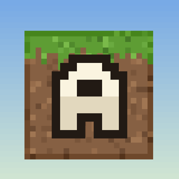

<p align="center">
  
</p>

<h1 align="center">Aksi — Horizon для iOS / Horizon for iOS</h1>

<p align="center">
  Неофициальный порт Horizon (Minecraft: Java Edition на Rust) на iPhone и iPad<br>
  Unofficial iOS port of Horizon, Minecraft: Java Edition rewritten in Rust
</p>

<p align="center">
  <a href="https://github.com/akissed-lab/horizon/releases/latest"></a>
  <a href="https://github.com/akissed-lab/horizon/releases"></a>
  
  
  
  <a href="LICENSE"></a>
</p>

<p align="center">
  <a href="https://github.com/akissed-lab/horizon/releases/latest"><b>Скачать IPA / Download IPA</b></a> ·
  <a href="#русский">Русский</a> ·
  <a href="#english">English</a> ·
  <a href="IOS.md">IOS.md</a>
</p>

> Ранняя версия, многое ещё не доделано. / Early build, plenty is still unfinished.

## Русский

### Что это

Aksi — это Minecraft: Java Edition 26.3, заново написанный на Rust (нативный клиент, без Java),
собранный как приложение для iPhone и iPad. Рендер идёт через Metal, звук — через CoreAudio,
управление — сенсорное и мышью/клавиатурой по Bluetooth.

Это неофициальный порт [Horizon](https://github.com/horizon-rust/horizon) на iOS. Проект — форк
https://github.com/horizon-rust/horizon, и вся основная работа — заслуга оригинальных авторов
Horizon. Спасибо им. Порт для iOS и оформление Aksi сделал [akissed](https://github.com/akissed-lab);
до этого тот же форк собирался под Android.

Оригинальный README лежит в [README.upstream.md](README.upstream.md), а всё про сборку, установку
и ограничения iOS — в [IOS.md](IOS.md).

### Возможности

- Нативная игра на Rust, без Java и эмуляции; рендер через Metal.
- Сенсорное управление: джойстик движения, обзор перетаскиванием, прыжок/присед, хотбар,
  инвентарь, пауза и чат. В полях ввода открывается системная клавиатура iOS.
- **Отдельный лаунчер Aksi до запуска движка**: «Продолжить», все миры, новый мир, сетевая
  игра, настройки и аккаунт. Движок стартует только после нажатия «Играть»; когда мир закрывается,
  лаунчер возвращается.
- Вход **Ely.by** по нику и паролю: ник и скин подтягиваются с сервера, пароль нигде не
  сохраняется.
- Настройки в лаунчере: цвет акцента и пресеты памяти (Экономно / Обычно / Максимум), чтобы игра
  стабильнее шла на телефоне. Те же настройки открываются кнопкой **Aksi** в меню паузы, а пресет
  памяти применяется при входе в мир.
- Полноэкранный ландшафтный режим; системные свайпы с краёв не срабатывают случайно.
- Миры, ресурспаки и шейдерпаки как на ПК; сохранения можно копировать через Finder или Files.

### Установка

1. Скачайте `Horizon.ipa` со страницы [Releases](https://github.com/akissed-lab/horizon/releases).
2. Подпишите его своим сертификатом в **ESign**, **Feather**, **AltStore/Sideloadly** или
   установите через **TrollStore**.
3. Установите приложение и доверьте сертификату: **Настройки → Основные → VPN и управление
   устройством**.
4. Запустите Aksi один раз: появится папка `На iPhone → Aksi` (внутри — `Documents/Horizon`).

Бесплатный Apple ID работает, но подпись живёт 7 дней; платный сертификат — год. App Store не
предусмотрен: это неофициальный порт.

### Файлы игры

В IPA **нет файлов Minecraft**. Нужна своя лицензионная копия **Minecraft: Java Edition 26.3**.
Файлы готовятся на ПК (нужна Java):

```sh
cargo run --release -p horizon-prepare -- --prepare --server-jar ~/Downloads/server.jar
cargo run --release -p horizon-prepare -- sounds    # необязательно
```

Затем скопируйте **содержимое** папки `.local/horizon-client/26.3/` (не саму папку) в
`Documents/Horizon/resources/` — через Finder или приложение Files. Приложение стартует в лаунчере
Aksi; пока ресурсов нет, кнопка «Играть» неактивна и лаунчер подсказывает, куда их положить.
Файлы игры он не скачивает.

Подробности и структура папок: [IOS.md](IOS.md).

### Ограничения

- **Нет входа Microsoft.** Пока доступны локальные миры, офлайн-серверы и аккаунт **Ely.by**.
- **Память.** Игра занимает около 2.2 ГБ; на 4 ГБ телефоне iOS обычно закрывает её при загрузке
  мира. Рекомендуется 6 ГБ ОЗУ и дальность прорисовки 4–6 (пресет «Экономно»).
- Моды, HDR и контроллеры не поддерживаются; буфер обмена общий только внутри игры.

Лог: `На iPhone → Aksi → logs → latest.log`. Падения: `crash-reports/`.

### Сборка

IPA собирается на macOS-раннере GitHub Actions: форкните репозиторий, включите Actions и
запустите workflow **ios** (или отправьте тег `v*` — он опубликует релиз). Мак не нужен.
Локально: `./packaging/ios/build_ipa.sh`.

### Благодарности

Игра — работа авторов [Horizon](https://github.com/horizon-rust/horizon)
([playhorizon.dev](https://playhorizon.dev)). Horizon распространяется по лицензии MIT; Aksi
не связан с Mojang или Microsoft.

Порт для iOS и брендинг Aksi: [akissed](https://github.com/akissed-lab).

## English

### What this is

Aksi is Minecraft: Java Edition 26.3 rewritten from scratch in Rust (a native client, no Java),
packaged as an iPhone and iPad app. Rendering is Metal, sound is CoreAudio, and input is touch plus
Bluetooth mouse and keyboard.

This is an unofficial iOS port of [Horizon](https://github.com/horizon-rust/horizon). It is a fork
of https://github.com/horizon-rust/horizon, and almost all the real work belongs to the original
Horizon authors — thank you. The iOS port and the Aksi branding are by
[akissed](https://github.com/akissed-lab); the same fork was previously built for Android.

The upstream README is [README.upstream.md](README.upstream.md); iOS build, install and limits are
in [IOS.md](IOS.md).

### Features

- A native Rust game, no Java or emulation; Metal rendering.
- Touch controls: movement joystick, look by dragging, jump/sneak, hotbar, inventory, pause and chat.
  Text fields open the iOS system keyboard.
- A separate **Aksi launcher** before the engine starts: Continue, all worlds, a new world,
  multiplayer, settings and the account. The engine starts only when Play is pressed, and the
  launcher comes back when a world closes.
- **Ely.by** sign-in with a nickname and password: the nickname and skin come from the server, and
  the password is never stored.
- Launcher settings: an accent colour and memory presets (Economy / Normal / Maximum) to keep the
  game stable on a phone. The same settings open with the **Aksi** button in the pause menu, and the
  memory preset is applied when a world opens.
- Fullscreen landscape; a swipe from a screen edge no longer leaves the game by accident.
- Worlds, resource packs and shader packs as on desktop; saves copy in and out through Finder or the
  Files app.

### Install

1. Download `Horizon.ipa` from [Releases](https://github.com/akissed-lab/horizon/releases).
2. Sign it with your certificate in **ESign**, **Feather**, **AltStore/Sideloadly**, or install it
   with **TrollStore**.
3. Install, then trust the certificate: **Settings → General → VPN & Device Management**.
4. Launch Aksi once; it creates `On My iPhone → Aksi` (`Documents/Horizon` inside).

A free Apple ID works but the signature expires after 7 days; a paid certificate lasts a year. There
is no App Store distribution: this is an unofficial port.

### Game files

The IPA contains **no Minecraft files**. You need your own legit copy of **Minecraft: Java Edition
26.3**. Prepare the files on a PC (needs Java):

```sh
cargo run --release -p horizon-prepare -- --prepare --server-jar ~/Downloads/server.jar
cargo run --release -p horizon-prepare -- sounds    # optional
```

Copy the **contents** of `.local/horizon-client/26.3/` (not the folder itself) into
`Documents/Horizon/resources/` through Finder or the Files app. The app starts in the Aksi launcher;
until the files are there, Play stays disabled and the launcher says where they go. It never
downloads game files itself.

Folder layout and details: [IOS.md](IOS.md).

### Limitations

- **No Microsoft login.** Local worlds, offline-mode servers and **Ely.by** accounts only.
- **Memory.** The game takes about 2.2 GB; on a 4 GB phone iOS usually kills it while a world loads.
  6 GB of RAM and a render distance of 4–6 (the "Economy" preset) are recommended.
- Mods, HDR and controllers are unsupported; the clipboard is in-game only.

Log: `On My iPhone → Aksi → logs → latest.log`. Crashes: `crash-reports/`.

### Build

The IPA is built on GitHub Actions' macOS runners: fork the repository, enable Actions and run the
**ios** workflow (or push a `v*` tag, which publishes a release). No Mac needed. Locally:
`./packaging/ios/build_ipa.sh`.

### Credits

The game is the work of the [Horizon](https://github.com/horizon-rust/horizon) authors
([playhorizon.dev](https://playhorizon.dev)). Horizon is MIT licensed; Aksi is not approved by or
associated with Mojang or Microsoft.

iOS port and Aksi branding: [akissed](https://github.com/akissed-lab).
